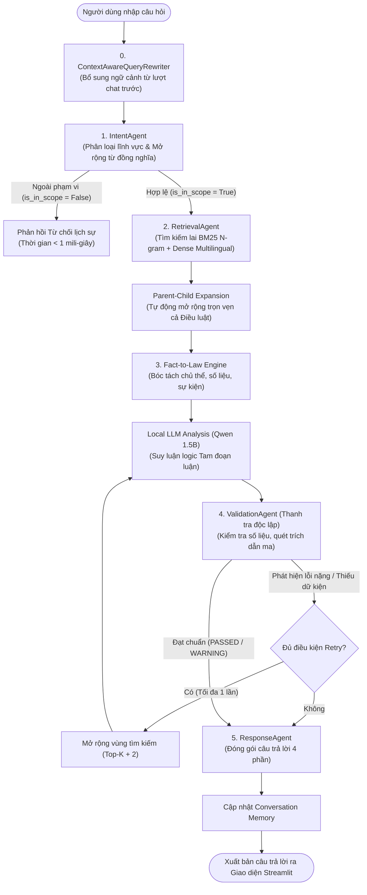
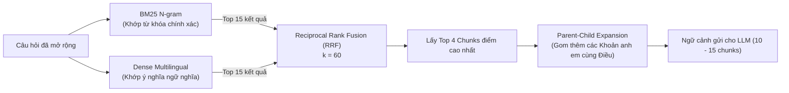
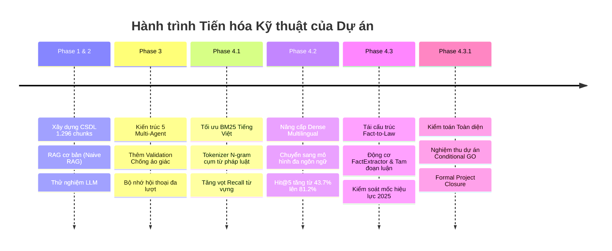

# GIÁO TRÌNH HƯỚNG DẪN TOÀN DIỆN DỰ ÁN AGENTIC AI LEGAL CHATBOT
## DÀNH CHO NGƯỜI MỚI BẮT ĐẦU TỪ CON SỐ 0

---

> **Dự án:** Agentic AI Legal Chatbot – Tư vấn pháp luật Lao động và Bảo hiểm xã hội Việt Nam  
> **Cột mốc hoàn thành:** Giai đoạn 4.3 (Phase 4.3.1 Acceptance & Closure)  
> **Môi trường vận hành:** Windows 11, CPU Intel Core i5, RAM 16 GB, Local/Offline 100%  
> **Tài liệu bổ trợ:** [PROJECT_GLOSSARY.md](file:///d:/A_DATN/Agentic_Legal_Chatbot/reports/PROJECT_GLOSSARY.md) (Từ điển thuật ngữ), [PROJECT_DEFENSE_QA.md](file:///d:/A_DATN/Agentic_Legal_Chatbot/reports/PROJECT_DEFENSE_QA.md) (Bộ câu hỏi & đáp bảo vệ đồ án)

---

## MỤC LỤC

1. [Phần I: Tổng quan dự án từ con số 0](#phần-i-tổng-quan-dự-án-từ-con-số-0)
2. [Phần II: Toàn cảnh Kiến trúc Hệ thống Pipeline](#phần-ii-toàn-cảnh-kiến-trúc-hệ-thống-pipeline)
3. [Phần III: Tri thức Pháp luật và Dữ liệu Knowledge Base](#phần-iii-tri-thức-pháp-luật-và-dữ-liệu-knowledge-base)
4. [Phần IV: Bảng tra cứu Các Mô hình, Thư viện và Công nghệ](#phần-iv-bảng-tra-cứu-các-mô-hình-thư-viện-và-công-nghệ)
5. [Phần V: Bóc tách Cấu trúc Mã nguồn (Source Code Walkthrough)](#phần-v-bóc-tách-cấu-trúc-mã-nguồn-source-code-walkthrough)
6. [Phần VI: Giải mã Toàn bộ Tham số Cấu hình (Configuration Deep Dive)](#phần-vi-giải-mã-toàn-bộ-tham-số-cấu-hình-configuration-deep-dive)
7. [Phần VII: Lịch sử và Hành trình Cải tiến Kỹ thuật (Phase 1 -> Phase 4.3)](#phần-vii-lịch-sử-và-hành-trình-cải-tiến-kỹ-thuật-phase-1---phase-43)
8. [Phần VIII: Giải thích Các Chỉ số Đo lường và Hiệu năng Thực tế](#phần-viii-giải-thích-các-chỉ-số-đo-lường-và-hiệu-năng-thực-tế)
9. [Phần IX: Mô phỏng Luồng Xử lý 3 Câu hỏi Điển hình từ A đến Z](#phần-ix-mô-phỏng-luồng-xử-lý-3-câu-hỏi-điển-hình-từ-a-đến-z)
10. [Phần X: Những Hạn chế Thực tế và Hướng Phát triển Tương lai](#phần-x-những-hạn-chế-thực-tế-và-hướng-phát-triển-tương-lai)

---

## PHẦN I: TỔNG QUAN DỰ ÁN TỪ CON SỐ 0

### 1. Chatbot là gì?
**Chatbot** (ghép từ *Chat* - trò chuyện và *Robot* - người máy) là một chương trình máy tính được thiết kế để đối thoại tự động với người dùng bằng ngôn ngữ tự nhiên (văn bản gõ vào hoặc giọng nói).
- *Ví dụ đời thường:* Hộp chat tự động của fanpage bán hàng hỏi bạn *"Bạn cần tìm quần áo size gì?"* khi bạn vừa nhắn tin.

### 2. Chatbot truyền thống hoạt động như thế nào và tại sao nó thất bại?
Chatbot thế hệ cũ (Rule-based Chatbot) hoạt động theo các **kịch bản cây quyết định (Decision Tree)** hoặc **bắt từ khóa cứng (If-Else / Keyword Matching)**.
- *Cách nó chạy:* Nếu câu có chữ "lương" -> bấm phím 1; nếu có chữ "nghỉ phép" -> bấm phím 2.
- *Điểm yếu chí mạng:* Người dùng chỉ cần hỏi khác đi một chút, ví dụ *"Cty bắt làm thêm giờ sml ban đêm tính xèng sao sếp?"*, chatbot truyền thống sẽ báo lỗi ngay: *"Xin lỗi, tôi không hiểu câu hỏi"*. Nó không có khả năng hiểu ngữ nghĩa, không biết suy luận logic và không xử lý được các tình huống pháp lý đa dạng.

### 3. Chatbot sử dụng AI khác gì Chatbot thông thường?
Chatbot sử dụng **Trí tuệ nhân tạo (AI)** và **Xử lý ngôn ngữ tự nhiên (NLP)** không khớp từng chữ cái một cách máy móc, mà nó **học cách hiểu ý nghĩa (ngữ nghĩa - semantics)** đằng sau câu nói của con người.
- Dù bạn hỏi: *"Nghỉ đẻ được mấy tháng?"*, *"Chế độ sinh con của lao động nữ thế nào?"*, hay *"Thời gian nghỉ hưởng thai sản là bao lâu?"*, AI đều nhận diện được bạn đang hỏi về cùng một vấn đề pháp lý: **Chế độ thai sản**.

### 4. Large Language Model (LLM) là gì?
**Large Language Model (LLM - Mô hình ngôn ngữ lớn)** là một mạng nơ-ron nhân tạo khổng lồ chứa hàng tỷ tham số (parameters). Nó được cho đọc hàng triệu cuốn sách, bài báo và trang web để học quy luật ngữ pháp, từ vựng và tri thức của nhân loại.
- Dự án của chúng ta sử dụng mô hình **Qwen2.5-1.5B-Instruct** (mô hình 1.5 tỷ tham số do tập đoàn Alibaba phát triển, rất giỏi tiếng Việt và lập luận logic, được nén lại để chạy trực tiếp trên máy tính thông thường).

### 5. Vì sao LLM có thể hiểu và trả lời câu hỏi?
Về bản chất toán học, LLM hoạt động như một cỗ máy **dự đoán từ tiếp theo có xác suất cao nhất (Next-token Prediction)**. Nhờ được đọc lượng dữ liệu khổng lồ, nó hiểu sâu sắc cấu trúc câu, mối quan hệ giữa các khái niệm và có khả năng tóm tắt, giải thích cũng như suy luận logic tương tự như một người đọc sách uyên bác.

### 6. Vì sao TUYỆT ĐỐI KHÔNG NÊN chỉ dùng LLM đơn thuần để tư vấn pháp luật?
Nếu bạn cài một LLM độc lập (như ChatGPT thuần túy) rồi hỏi luật Việt Nam, bạn sẽ gặp 3 hiểm họa chết người:
1. **Ảo giác AI (Hallucination):** LLM sinh ra câu trả lời dựa trên xác suất từ ngữ. Khi không chắc chắn, nó sẽ **tự tin bịa đặt ra điều luật không có thật** (ví dụ tự bịa ra *"Theo Điều 999 Bộ luật Lao động, tiền thưởng tết bắt buộc là 1 tháng lương"* dù luật không hề có điều này).
2. **Kiến thức lỗi thời (Outdated Knowledge):** LLM chỉ biết những gì đã học tại thời điểm được huấn luyện. Nó không tự cập nhật được các luật mới (như **Luật Bảo hiểm xã hội 2024 số 41/2024/QH15** vừa được Quốc hội thông qua và có hiệu lực từ 01/07/2025).
3. **Không thể tra cứu số trang / căn cứ chính xác:** LLM trả lời chung chung, không thể chỉ ra thông tin đó nằm ở trang bao nhiêu của Công báo hay Văn bản hợp nhất nào để người dùng mang ra tòa án đối chất.

### 7. RAG là gì? Tại sao RAG là "vũ khí giải cứu" cho AI Pháp luật?
**RAG (Retrieval-Augmented Generation - Tạo sinh có tăng cường truy xuất)** là kỹ thuật kết hợp giữa 2 việc:
- **Retrieval (Truy xuất):** Khi người dùng hỏi, hệ thống chưa cho LLM trả lời ngay. Nó đóng vai người thủ thư, chạy vào kho dữ liệu luật chính thống của dự án để tìm ra đúng 3-4 đoạn luật liên quan nhất.
- **Generation (Tạo sinh):** Hệ thống kẹp các đoạn luật vừa tìm được vào lời nhắc và ra lệnh cho LLM: *"Đây là Điều 113 Bộ luật Lao động được trích xuất từ tài liệu chính thức. Hãy đọc kỹ đoạn này và trả lời cho người dùng. Cấm nói ngoài tài liệu."*
- *Hình ảnh so sánh:* Thay vì bắt học sinh thi môn Luật bằng cách **nhớ vẹt trong đầu (LLM thuần)** dẫn đến nhớ nhầm, RAG là phương pháp **thi mở sách (Open-book Exam)**: học sinh được phát đúng trang sách luật cần thiết để đọc và viết lời giải.

### 8. Agentic AI là gì? Khác gì với RAG thông thường?
- **RAG thông thường (Naive RAG):** Hoạt động theo 1 đường thẳng cứng nhắc: Nhận câu hỏi -> Tìm tài liệu -> Gửi cho LLM -> Trả kết quả. Nếu câu hỏi mơ hồ, hoặc tài liệu tìm về bị sai, hệ thống vẫn nhắm mắt trả lời bừa.
- **Agentic AI (Hệ thống AI dựa trên Tác tử):** Chia hệ thống thành nhiều **"nhân viên chuyên trách" (Agents)**. Mỗi Agent có trí thông minh riêng, mục tiêu riêng và có thể kiểm tra chéo nhau.
  - Có nhân viên chuyên đón tiếp, phân loại câu hỏi (`IntentAgent`).
  - Có nhân viên chuyên đi thư viện tìm sách (`RetrievalAgent`).
  - Có luật sư chuyên bóc tách dữ kiện và suy luận (`LegalAnalysisAgent`).
  - Có thanh tra độc lập chuyên soi lỗi, kiểm tra xem luật sư có bịa luật không (`ValidationAgent`).
  - Có thư ký chuyên trình bày văn bản theo quy chuẩn công vụ (`ResponseAgent`).

### 9. Dự án này giải quyết bài toán gì trong đời sống?
Người lao động và các doanh nghiệp vừa và nhỏ tại Việt Nam thường gặp khó khăn rất lớn khi đọc các văn bản quy phạm pháp luật dày hàng trăm trang với văn phong pháp lý phức tạp. Thuê luật sư tư vấn thì tốn kém chi phí, còn tự tìm trên mạng thì dễ vướng phải thông tin cũ hết hiệu lực.  
Dự án tạo ra một **Chatbot chuyên gia pháp lý ảo**, hoạt động **100% miễn phí, bảo mật cục bộ trên máy tính cá nhân (không gửi dữ liệu đi đâu)**, giúp người dân tra cứu quyền lợi thai sản, ốm đau, tiền lương làm thêm giờ, trợ cấp thôi việc một cách chính xác kèm số điều, số trang chính thức.

### 10. Đầu vào, Quá trình xử lý và Đầu ra của hệ thống
- **Đầu vào (Input):** Câu hỏi bằng tiếng Việt đời thường của người dùng (ví dụ: *"Công ty nợ lương 2 tháng em nghỉ việc ngay được không?"*).
- **Quá trình xử lý:** Hệ thống chạy qua dây chuyền 5 Agent điều phối tập trung, kết hợp tìm kiếm lai (Hybrid Search) và suy luận Tam đoạn luận.
- **Đầu ra (Output):** Văn bản định dạng Markdown chuẩn gồm 4 phần:
  1. *Kết luận dứt khoát* (Được nghỉ việc ngay hay không).
  2. *Căn cứ pháp lý chính thức* (Trích rõ Điều, Khoản, số trang, số hiệu văn bản hợp nhất).
  3. *Giải thích chi tiết* (Phân tích điều kiện luật định).
  4. *Lưu ý thực tế* (Cảnh báo mốc hiệu lực, ngoại lệ).

---

## PHẦN II: TOÀN CẢNH KIẾN TRÚC HỆ THỐNG PIPELINE

Toàn bộ hệ thống được điều phối bởi tệp trung tâm [`src/agents/orchestrator.py`](file:///d:/A_DATN/Agentic_Legal_Chatbot/src/agents/orchestrator.py) thông qua sơ đồ luồng dữ liệu khép kín:



---

### Chi tiết 5 Bước xử lý trong Pipeline:

#### 1. Bước 0 & 1: Tiếp nhận và `IntentAgent`
- **Mục tiêu:** Hiểu người dùng muốn gì và xác định câu hỏi có thuộc phạm vi giải quyết của hệ thống hay không.
- **Cách thức hoạt động:**
  - Nhận diện các từ khóa tiếng lóng, đời thường thông qua từ điển đồng nghĩa `SYNONYM_EXPANSION_MAP` (ví dụ: *"nghỉ đẻ"* tự động được gắn thêm *"chế độ thai sản", "sinh con"*).
  - Phân loại lĩnh vực vào 4 nhóm:
    1. `labor_law`: Liên quan đến Bộ luật Lao động (hợp đồng, tiền lương, thử việc, sa thải).
    2. `social_insurance`: Liên quan đến Luật Bảo hiểm xã hội (thai sản, ốm đau, hưu trí).
    3. `mixed`: Câu hỏi hỗn hợp đan xen cả 2 luật (ví dụ: nghỉ việc công ty có trả lương và chốt sổ BHXH không).
    4. `out_of_scope`: Câu hỏi hoàn toàn nằm ngoài phạm vi (giao thông, đất đai, hình sự).
- **Cơ chế ngắt sớm (Fast Exit):** Nếu phát hiện câu hỏi thuộc `out_of_scope`, hệ thống lập tức xuất thông báo từ chối lịch sự trong **chưa đầy 1 mili-giây**, không gọi công cụ tìm kiếm và không bật LLM, giúp tiết kiệm 100% điện năng và CPU máy tính.

---

#### 2. Bước 2: `RetrievalAgent` (Thủ thư thông minh)
Đây là trái tim của hệ thống RAG, chịu trách nhiệm tìm đúng mẩu luật trong 1.296 mẩu văn bản. Để không bỏ sót tài liệu, hệ thống sử dụng **Tìm kiếm lai (Hybrid Search)** kết hợp 2 trường phái:



##### A. Thuật ngữ cốt lõi trong Tìm kiếm:
- **BM25 (Best Matching 25):** Thuật toán tìm kiếm đếm số lần từ khóa xuất hiện trong văn bản. Điểm đặc biệt của BM25 là nó tính toán **độ hiếm của từ (IDF - Inverse Document Frequency)**: Từ nào xuất hiện ở khắp mọi nơi (như "là", "và", "của") sẽ bị hạ điểm rất thấp; còn từ chuyên ngành hiếm gặp (như "sa thải", "thôi việc", "phụ cấp") xuất hiện sẽ được cộng điểm rất cao.
- **N-gram (trong BM25 V2):** Thay vì tách từng chữ rời rạc khiến mất nghĩa (*"hợp"*, *"đồng"*, *"lao"*, *"động"*), hệ thống tự ghép thành cụm 2 chữ (Bigram) và 3 chữ (Trigram) theo từ điển pháp lý: *"hợp đồng lao động"*, *"bảo hiểm xã hội"*.
- **Embedding:** Biến một câu văn thành một danh sách gồm **384 con số** (Vector). Các câu có cùng ý nghĩa sẽ có các con số gần giống nhau.
- **Cosine Similarity:** Công thức hình học tính góc giữa 2 vectơ. Nếu 2 vectơ chỉ cùng hướng (góc = 0 độ), Cosine = 1 (ý nghĩa giống hệt nhau). Nếu lệch hướng 90 độ, Cosine = 0 (hoàn toàn không liên quan).
- **Dense Retrieval:** Dùng mô hình đa ngôn ngữ `paraphrase-multilingual-MiniLM-L12-v2` để so sánh độ tương đồng ngữ nghĩa giữa câu hỏi và tài liệu luật.
- **Reciprocal Rank Fusion (RRF):** Công thức toán học hòa giải và gộp 2 danh sách kết quả của BM25 và Dense.
  $$\text{Điểm RRF}(d) = \sum_{m \in \{\text{BM25}, \text{Dense}\}} \frac{w_m}{k + \text{rank}_m(d)}$$
  *Ý nghĩa các ký hiệu:*
  - $d$: Đoạn văn bản luật đang xét.
  - $\text{rank}_m(d)$: Thứ hạng của đoạn văn đó trong danh sách $m$ (hạng 1, hạng 2,...).
  - $k$: Hằng số làm mượt, trong dự án đặt $k = 60$ để ngăn các tài liệu top 1 lấn át hoàn toàn các vị trí sau.
  - $w_m$: Trọng số đóng góp của từng phương pháp ($w_{\text{BM25}} = 0.5$, $w_{\text{Dense}} = 0.5$).
  - *Ví dụ dễ hiểu:* Điều 113 đứng hạng 1 bên BM25 và đứng hạng 2 bên Dense. Điểm sẽ là:
    $$\frac{0.5}{60 + 1} + \frac{0.5}{60 + 2} = \frac{0.5}{61} + \frac{0.5}{62} \approx 0.00819 + 0.00806 = 0.01625$$
    Điểm này cao hơn hẳn một tài liệu chỉ đứng hạng 1 ở một bên nhưng bên kia không tìm thấy.
- **Parent-Child Expansion (Mở rộng Cha - Con):** Các điều luật thường chia thành nhiều Khoản liên kết chặt chẽ với nhau. Nếu công cụ tìm kiếm chỉ vớt được Khoản 1, có thể ngoại lệ hoặc mức phạt lại nằm ở Khoản 2 ngay bên dưới. `RetrievalAgent` sẽ tự động quét cơ sở dữ liệu để bốc trọn vẹn cả Điều luật chứa Khoản đó gửi cho LLM, đảm bảo không bao giờ bị cắt vụn ngữ cảnh.

---

#### 3. Bước 3: `LegalAnalysisAgent` (Chuyên viên lập luận Fact-to-Law)
Đây là nơi mô hình ngôn ngữ lớn cục bộ **Qwen2.5-1.5B-Instruct** làm việc. Để mô hình nhỏ (1.5B) không nói nhảm, hệ thống trang bị cho nó một cấu trúc tư duy logic chặt chẽ gọi là **Tam đoạn luận Pháp lý (Fact-to-Law Syllogism)**:

```
[ĐẠI TIỀN ĐỀ - Căn cứ Luật]
Điều 35 Khoản 2 Bộ luật Lao động: Người lao động có quyền nghỉ việc ngay không cần báo trước 
nếu không được trả đủ lương hoặc trả lương không đúng thời hạn.
           +
[TIỂU TIỀN ĐỀ - Dữ kiện Người dùng]
Dữ kiện bóc tách: Người lao động bị công ty nợ lương 2 tháng liên tiếp.
           ||
           ▼
[KẾT LUẬN PHÁP LÝ]
Người lao động HOÀN TOÀN CÓ QUYỀN đơn phương chấm dứt hợp đồng lao động ngay lập tức 
mà không cần báo trước cho công ty.
```

- **Thành phần `FactExtractor`:** Chạy bằng biểu thức chính quy (Regex) tốc độ cao, bóc tách sẵn:
  - *Chủ thể:* Người lao động hay Người sử dụng lao động?
  - *Số liệu:* 2 tháng, 60 ngày, 15 triệu?
  - *Sự kiện pháp lý:* Nợ lương, sa thải, sinh con, tai nạn?
  - *Dữ kiện còn thiếu:* Chưa biết loại hợp đồng xác định hay không xác định thời hạn?
  - *Mốc thời gian:* Sự việc xảy ra sau ngày 01/07/2025 thì phải áp dụng Luật Bảo hiểm xã hội 2024.
- Nhờ có khung dữ kiện dọn sẵn này, LLM 1.5B chỉ việc đọc và ráp logic, không phải phỏng đoán lung tung.

---

#### 4. Bước 4: `ValidationAgent` (Thanh tra Chống ảo giác độc lập)
Sau khi LLM viết xong câu trả lời, `ValidationAgent` lập tức nhảy vào kiểm tra độc lập bằng mã nguồn Python thuần (không dùng LLM để tự chấm điểm LLM vì LLM có thể tiếp tục bị ảo giác):
1. **Quét trích dẫn ma (Hallucinated Citations):** Trích xuất toàn bộ các cụm từ *"Điều X Khoản Y"* mà LLM nhắc tới trong câu trả lời. Sau đó tra cứu thẳng vào 1.296 chunks trong CSDL. Nếu LLM nhắc đến một điều khoản không có thật -> Lập tức cảnh báo hoặc loại bỏ.
2. **Kiểm tra số liệu không căn cứ (Unsupported Numbers):** So khớp từng con số định lượng (số ngày, tỷ lệ phần trăm) giữa câu trả lời và văn bản gốc.  
   *Ví dụ thực tế:* Tại kịch bản FTL_03, LLM sinh ra con số "300%", `ValidationAgent` phát hiện số này không thuộc điều khoản đang trích dẫn và lập tức gắn tag:  
   *⚠️ "Cảnh báo kiểm định: Tỷ lệ '300%' có xuất hiện trong ngữ cảnh nhưng KHÔNG thuộc Điều/Khoản được trích dẫn làm căn cứ!"*

---

#### 5. Bước 5: `ResponseAgent` (Thư ký định dạng chuẩn mực)
Gom toàn bộ kết quả đã qua kiểm định, sắp xếp thành văn bản Markdown chuẩn mực gồm 4 phần:
1. **KẾT LUẬN:** Trả lời trực diện, ngắn gọn vào câu hỏi của người dùng.
2. **CĂN CỨ PHÁP LÝ:** Liệt kê danh sách các văn bản luật, số hiệu, số trang chính xác trong tài liệu gốc.
3. **GIẢI THÍCH CHI TIẾT:** Trình bày điều kiện, mức hưởng và phân tích logic.
4. **LƯU Ý VÀ ÁP DỤNG THỰC TIỄN:** Nhắc nhở mốc hiệu lực thi hành, các trường hợp ngoại lệ hoặc cảnh báo dữ kiện người dùng còn thiếu cần bổ sung.

---

## PHẦN III: TRI THỨC PHÁP LUẬT VÀ DỮ LIỆU KNOWLEDGE BASE

### 1. Dữ liệu văn bản gốc trong dự án
Hệ thống được nạp 2 văn bản pháp luật nền tảng lưu tại thư mục [`data/official_documents/`](file:///d:/A_DATN/Agentic_Legal_Chatbot/data/official_documents/):

| Tên văn bản | Số hiệu văn bản | Ngày ban hành | Ngày có hiệu lực | Vai trò trong hệ thống |
| :--- | :---: | :---: | :---: | :--- |
| **Bộ luật Lao động** | `18/VBHN-VPQH` | 12/02/2026 | 01/01/2021 | Văn bản hợp nhất chính thức, chuẩn hóa toàn bộ quan hệ lao động, hợp đồng, tiền lương, thời giờ làm việc. |
| **Luật Bảo hiểm xã hội** | `41/2024/QH15` | 29/06/2024 | **01/07/2025** | Luật mới nhất của Quốc hội khóa XV, điều chỉnh các chế độ thai sản, ốm đau, hưu trí, BHXH một lần. |

### 2. Quy trình xử lý dữ liệu từ PDF thành Vector Database:
1. **Bóc tách PDF (`document_loader.py`):** Đọc từng trang tệp PDF, loại bỏ phần đầu trang/chân trang rác, giữ lại cấu trúc tiêu đề Chương, Mục, Điều.
2. **Cắt đoạn theo cấu trúc luật (`chunking.py`):**  
   Khác với các hệ thống RAG văn học cắt đoạn theo số lượng từ ngẫu nhiên (e.g. cứ 500 từ cắt 1 đoạn gây đứt gãy câu luật), hệ thống **cắt theo đúng phân cấp pháp lý**: Mỗi Điều luật là một Parent Chunk, mỗi Khoản là một Child Chunk.
   - Tổng cộng dự án đã bóc tách được **1.296 chunks** chuẩn từ **363 điều luật**.
3. **Lưu trữ đa định dạng:**
   - **BM25 Index (`data/processed/bm25_index.pkl`):** Lưu trữ bảng chỉ mục từ vựng phục vụ tìm kiếm từ khóa.
   - **ChromaDB (`vector_db/`):** Cơ sở dữ liệu vector lưu trữ 1.296 dãy số embedding phục vụ tìm kiếm ngữ nghĩa.

### 3. Vùng phủ dữ liệu và Những nội dung CHƯA CÓ:
- **Nội dung có:** Quan hệ lao động, Hợp đồng, Thử việc, Lương, Phép năm, Nghỉ lễ, Sa thải, Kỷ luật, Thai sản, Ốm đau, Hưu trí, BHXH một lần.
- **Nội dung CHƯA CÓ trong CSDL:**
  - **Luật Việc làm số 38/2013/QH13** (Quy định chi tiết về Bảo hiểm thất nghiệp - BHTN).
  - **Luật Bảo hiểm y tế** (Mức hưởng khám chữa bệnh BHYT đúng tuyến/trái tuyến).
  - **Luật Thuế thu nhập cá nhân** (Biểu thuế lũy tiến, mức giảm trừ gia cảnh).
  - **Các Nghị định xử phạt vi phạm hành chính** (Nghị định 12/2022/NĐ-CP).

---

## PHẦN IV: BẢNG TRA CỨU CÁC MÔ HÌNH, THƯ VIỆN VÀ CÔNG NGHỆ

Dưới đây là bảng giải thích toàn bộ các công nghệ thực sự có mặt trong mã nguồn dự án:

| Tên công nghệ / Thư viện | Nó là gì? | Dùng để làm gì trong dự án? | Nằm ở bước nào? | Nếu bỏ nó thì hậu quả ra sao? |
| :--- | :--- | :--- | :--- | :--- |
| **Python 3.11** | Ngôn ngữ lập trình chính | Viết toàn bộ mã nguồn xử lý logic, tính toán khoa học và điều phối hệ thống. | Toàn bộ dự án | Không thể chạy dự án. |
| **Streamlit** | Thư viện giao diện Web | Dựng giao diện Chatbot trực quan, thanh bên (Sidebar) hiển thị thông số RAM, thời gian từng Agent. | `app.py` | Người dùng phải gõ lệnh qua màn hình đen terminal, mất giao diện thân thiện. |
| **Hugging Face** | Kho lưu trữ AI mở | Nơi tải các mô hình mã nguồn mở (Embedding, Tokenizer) về máy tính. | Tải model offline | Phải tự xây dựng mô hình AI từ đầu (bất khả thi trên máy cá nhân). |
| **Qwen2.5-1.5B-Instruct** | Mô hình ngôn ngữ lớn (LLM) | Đóng vai "bộ não" tổng hợp thông tin, hiểu câu hỏi và viết câu trả lời tư vấn pháp lý. | `LegalAnalysisAgent` | Hệ thống chỉ trích xuất được văn bản thô, không biết giải thích logic câu hỏi. |
| **GGUF** | Định dạng tệp nén mô hình | Đóng gói mô hình LLM để có thể nạp và suy luận trực tiếp trên CPU x86 của máy tính. | `models/llm/` | Mô hình gốc dạng PyTorch rất nặng (~6-8 GB), CPU không thể chạy nổi hoặc sẽ bị tràn RAM. |
| **llama-cpp-python** | Cầu nối C++ và Python | Cho phép mã nguồn Python gọi thư viện `llama.cpp` viết bằng C++ siêu nhanh để chạy model LLM. | `legal_analysis_agent.py` | Tốc độ sinh chữ của Python thuần cực kỳ chậm, không thể chạy LLM cục bộ. |
| **Sentence-Transformers** | Thư viện tạo Vector | Biến văn bản chữ viết thành các dãy số embedding ngữ nghĩa. | `embedding.py` | Không thể thực hiện tìm kiếm ngữ nghĩa (Dense Retrieval). |
| **paraphrase-multilingual-MiniLM-L12-v2** | Mô hình Embedding đa ngôn ngữ | Mô hình chuyển đổi câu văn tiếng Việt thành vector 384 chiều với độ chính xác ngữ nghĩa cao. | `RetrievalAgent` (Dense) | Phải dùng mô hình tiếng Anh cũ, tìm kiếm tiếng Việt bị trượt rất nhiều (Hit@5 giảm một nửa). |
| **ChromaDB** | Cơ sở dữ liệu Vector cục bộ | Lưu trữ 1.296 vector tài liệu luật trên ổ cứng và tính toán tìm kiếm vector láng giềng gần nhất. | `vector_db/` | Mỗi lần người dùng hỏi lại phải tính toán lại 1.296 vector từ đầu, mất hàng phút cho mỗi câu hỏi. |
| **Rank-BM25** | Thư viện tìm kiếm từ khóa | Tính toán điểm số BM25Okapi dựa trên độ khớp từ vựng chính xác. | `bm25_ngram.py` | Mất khả năng tìm kiếm chính xác các số hiệu điều luật hay từ vựng kỹ thuật hiếm. |
| **Reciprocal Rank Fusion (RRF)** | Thuật toán hợp nhất thứ hạng | Trộn danh sách kết quả của BM25 và Dense Search thành bảng xếp hạng tối ưu duy nhất. | `hybrid_search.py` | Phải chọn 1 trong 2 công cụ tìm kiếm, mất đi sức mạnh cộng hưởng của tìm kiếm lai. |
| **psutil** | Thư viện đo tài nguyên hệ thống | Đo đạc dung lượng RAM tiến trình (Process RSS) và tỷ lệ chiếm dụng CPU thời gian thực. | Đo đạc benchmark | Không thể theo dõi hiện tượng rò rỉ bộ nhớ (Memory Leak) để đánh giá độ ổn định. |
| **Regex (`re`)** | Thư viện biểu thức chính quy | Tìm kiếm và bóc tách các mẫu chuỗi ký tự (số hiệu luật, ngày tháng, chủ thể) với tốc độ micro-giây. | `fact_reasoning.py` & `validation_agent.py` | Bộ bóc tách dữ kiện và bộ thanh tra chống ảo giác sẽ chạy rất chậm. |

---

## PHẦN V: BÓC TÁCH CẤU TRÚC MÃ NGUỒN (SOURCE CODE WALKTHROUGH)

### Bảng sơ đồ thư mục và tập tin cốt lõi:

| Thư mục / Tập tin | Chức năng chính | Vai trò trong kiến trúc | Tệp liên quan trực tiếp |
| :--- | :--- | :--- | :--- |
| [`app.py`](file:///d:/A_DATN/Agentic_Legal_Chatbot/app.py) | Ứng dụng giao diện Web Streamlit | Điểm tiếp nhận tương tác người dùng, hiển thị câu trả lời và thông số đo lường | `orchestrator.py` |
| [`config.py`](file:///d:/A_DATN/Agentic_Legal_Chatbot/config.py) | Tệp cấu hình tập trung | Định nghĩa toàn bộ đường dẫn, thông số mô hình, siêu tham số tìm kiếm và LLM | Tất cả các tệp trong `src/` |
| [`src/agents/orchestrator.py`](file:///d:/A_DATN/Agentic_Legal_Chatbot/src/agents/orchestrator.py) | Nhạc trưởng điều phối (Orchestrator) | Nhận câu hỏi, gọi tuần tự các Agent, xử lý vòng lặp retry, theo dõi RAM và độ trễ | Tất cả các Agent |
| [`src/agents/intent_agent.py`](file:///d:/A_DATN/Agentic_Legal_Chatbot/src/agents/intent_agent.py) | Tác tử phân loại ý định | Xác định lĩnh vực (lao động, BHXH, ngoài phạm vi) và mở rộng từ đồng nghĩa | `orchestrator.py` |
| [`src/agents/retrieval_agent.py`](file:///d:/A_DATN/Agentic_Legal_Chatbot/src/agents/retrieval_agent.py) | Tác tử truy xuất tri thức | Thực thi Hybrid Search kết hợp mở rộng Parent-Child cấp Điều luật | `hybrid_search.py` |
| [`src/agents/legal_analysis_agent.py`](file:///d:/A_DATN/Agentic_Legal_Chatbot/src/agents/legal_analysis_agent.py) | Tác tử phân tích pháp lý | Nạp Local LLM (Qwen 1.5B GGUF) và thực thi suy luận Tam đoạn luận Fact-to-Law | `fact_reasoning.py` |
| [`src/agents/fact_reasoning.py`](file:///d:/A_DATN/Agentic_Legal_Chatbot/src/agents/fact_reasoning.py) | Động cơ bóc tách dữ kiện | Regex bóc tách chủ thể, sự kiện, con số, dữ kiện thiếu và mốc hiệu lực 2025 | `legal_analysis_agent.py` |
| [`src/agents/validation_agent.py`](file:///d:/A_DATN/Agentic_Legal_Chatbot/src/agents/validation_agent.py) | Tác tử thanh tra kiểm định | Chốt chặn chống ảo giác: quét trích dẫn ma, kiểm định số liệu định lượng | `orchestrator.py` |
| [`src/agents/response_agent.py`](file:///d:/A_DATN/Agentic_Legal_Chatbot/src/agents/response_agent.py) | Tác tử đóng gói phản hồi | Định dạng câu trả lời Markdown 4 phần chuẩn mực công vụ | `orchestrator.py` |
| [`src/memory/conversation_memory.py`](file:///d:/A_DATN/Agentic_Legal_Chatbot/src/memory/conversation_memory.py) | Quản lý bộ nhớ hội thoại | Lưu vết lịch sử chat theo từng phiên làm việc (Session), tránh nhớ chéo ngữ cảnh | `orchestrator.py` |
| [`src/memory/query_rewriter.py`](file:///d:/A_DATN/Agentic_Legal_Chatbot/src/memory/query_rewriter.py) | Tác tử viết lại câu hỏi | Bổ sung chủ ngữ, đại từ thay thế cho các câu hỏi tiếp nối ở lượt chat sau | `orchestrator.py` |
| [`src/retrieval/hybrid_search.py`](file:///d:/A_DATN/Agentic_Legal_Chatbot/src/retrieval/hybrid_search.py) | Thuật toán tìm kiếm lai | Thực hiện thuật toán RRF kết hợp danh sách từ BM25Searcher và DenseSearcher | `bm25_ngram.py`, `embedding.py`|
| [`src/retrieval/bm25_ngram.py`](file:///d:/A_DATN/Agentic_Legal_Chatbot/src/retrieval/bm25_ngram.py) | Chỉ mục BM25 N-gram tiếng Việt | Tokenizer cụm từ ghép pháp luật chuyên dụng tiếng Việt | `hybrid_search.py` |
| [`src/retrieval/document_loader.py`](file:///d:/A_DATN/Agentic_Legal_Chatbot/src/retrieval/document_loader.py) | Bộ nạp tài liệu PDF | Bóc tách PDF văn bản pháp luật gốc thành cấu trúc số hóa | `chunking.py` |
| [`src/retrieval/chunking.py`](file:///d:/A_DATN/Agentic_Legal_Chatbot/src/retrieval/chunking.py) | Bộ chia nhỏ văn bản pháp luật | Cắt nhỏ văn bản theo cấu trúc Điều/Khoản thành 1.296 chunks | CSDL `vector_db` |

---

## PHẦN VI: GIẢI MÃ TOÀN BỘ THAM SỐ CẤU HÌNH (CONFIGURATION DEEP DIVE)

Toàn bộ các tham số điều khiển "sức mạnh" của hệ thống được quy định tại [`config.py`](file:///d:/A_DATN/Agentic_Legal_Chatbot/config.py):

| Tên tham số | Giá trị hiện tại | Ý nghĩa bản chất | Vì sao chọn giá trị này? | Nếu tăng hoặc giảm thì điều gì xảy ra? |
| :--- | :---: | :--- | :--- | :--- |
| `LLM_N_THREADS` | `6` | Số luồng tính toán CPU giao cho LLM suy luận. | CPU Intel Core i5 của máy có 6 lõi vật lý/luồng hiệu năng cao. | Giảm xuống 2-4: Tốc độ sinh chữ bị chậm đi một nửa. Tăng quá 6: Gây nghẽn cổ chai CPU, máy bị đơ giật. |
| `LLM_N_CTX` | `3072` | Kích thước cửa sổ ngữ cảnh (Context Window) tính bằng tokens. | Đủ chỗ chứa 1 câu hỏi + 10-15 chunks luật mở rộng + lời giải thích (~2.200 tokens). | Tăng lên 4096: Tốn thêm RAM (~500 MB) và sinh chữ chậm hơn. Giảm xuống 2048: Không đủ chỗ nhét các điều luật dài, bị tràn ngữ cảnh. |
| `LLM_TEMPERATURE` | `0.1` | Độ "sáng tạo / ngẫu nhiên" của câu chữ sinh ra (từ 0.0 đến 1.0). | Lĩnh vực pháp luật đòi hỏi **tính chính xác tuyệt đối, nghiêm cẩn**, không cần sự bay bổng nghệ thuật. | Tăng lên 0.7-1.0: LLM hành văn đa dạng hơn nhưng nguy cơ ảo giác và bịa luật tăng vọt. Đặt 0.1: Câu trả lời luôn nhất quán, bám sát luật. |
| `LLM_TOP_P` | `0.9` | Ngưỡng chọn lọc từ ngữ có tổng xác suất tích lũy hàng đầu. | Loại bỏ 10% các từ ngữ quá kỳ quặc hoặc hiếm gặp ở phần đuôi phân phối xác suất. | Giúp câu văn sinh ra tự nhiên, mượt mà mà vẫn đảm bảo độ tin cậy. |
| `RRF_K` | `60` | Hằng số làm mượt trong công thức hòa trộn Reciprocal Rank Fusion. | Chuẩn quốc tế tối ưu giúp cân bằng thứ hạng giữa BM25 và Dense Search. | Giảm xuống 30: Ưu tiên quá mức tài liệu đứng top 1 của một bên, làm giảm hiệu quả cộng hưởng. Tăng lên 100: Điểm số giữa các thứ hạng bị san phẳng, khó phân biệt tài liệu xuất sắc. |
| `RETRIEVAL_TOP_K` | `4` | Số lượng chunks tinh hoa được chọn sau khi lọc RRF để gửi cho LLM. | Đủ bao quát 1-2 điều luật trọng tâm mà không làm "loãng" prompt của LLM. | Tăng lên 10: Prompt quá dài, LLM bị phân tâm ("lạc lối ở giữa" - Lost in the middle). Giảm xuống 1-2: Có nguy cơ thiếu các khoản quy định ngoại lệ. |
| `RETRIEVAL_CANDIDATE_POOL`| `15` | Số lượng ứng viên mà BM25 và Dense bốc về ban đầu trước khi tính điểm RRF. | Báo cáo kiểm toán Phase 4 đã chứng minh 15 là con số vàng trên tập 1.296 chunks. | Mở rộng lên 50 (như thực nghiệm kiểm chứng): Bị nhiễm nhiều chunks rác ngữ nghĩa, làm trôi mất điều luật đúng ra khỏi Top-K. |
| `PARENT_CHILD_EXPAND` | `True` | Bật tính năng tự động gom các Khoản anh em cùng Điều luật. | Đảm bảo tính toàn vẹn của Điều luật (không bỏ sót ngoại lệ ở các khoản sau). | Nếu tắt (`False`): Thường xuyên bị sót các điều kiện loại trừ hoặc mức phạt quy định ở các khoản cuối. |
| `MAX_PARENT_CHILD_SIBLINGS`| `5` | Số lượng Khoản anh em tối đa được gom thêm cho mỗi Điều. | Ngăn chặn các Điều luật quá dài (như Điều 115 có quá nhiều khoản) làm tràn ngập ngữ cảnh. | Đảm bảo ngữ cảnh vừa vặn trong giới hạn 3.072 tokens của mô hình. |
| `MAX_RETRY_ATTEMPTS` | `1` | Số lần thử lại tối đa khi `ValidationAgent` phát hiện câu trả lời chưa đạt. | Cho phép hệ thống sửa sai 1 lần duy nhất bằng cách mở rộng vùng tìm kiếm (`Top-K + 2`). | Không cho retry nhiều lần (> 2) để tránh làm thời gian phản hồi bị kéo dài quá mức (mỗi lần retry tốn thêm ~25s). |

---

## PHẦN VII: LỊCH SỬ VÀ HÀNH TRÌNH CẢI TIẾN KỸ THUẬT (PHASE 1 -> PHASE 4.3)

Để đạt được chất lượng nghiệm thu hiện tại, dự án đã trải qua 4 giai đoạn tiến hóa kỹ thuật bài bản dựa trên các kiểm nghiệm thực tế:



### Chi tiết các bước nhảy vọt kỹ thuật:

#### 1. Cải tiến BM25 V1 lên BM25 V2 N-gram (Phase 4.1)
- *Vấn đề của bản cũ:* BM25 V1 dùng bộ tách từ unigram mặc định, tách các từ ghép tiếng Việt thành các từ đơn (*"hợp"*, *"đồng"*, *"lao"*, *"động"*). Khi người dùng hỏi về "hợp đồng lao động", máy tính đếm từ "lao động" ở mọi nơi, làm điểm số bị loãng.
- *Giải pháp mới:* Xây dựng bộ Tokenizer nhận diện từ ghép pháp luật tiếng Việt (`bm25_ngram.py`), gom các cụm từ quan trọng lại thành một khối thống nhất (*"hợp_đồng_lao_động"*, *"bảo_hiểm_xã_hội"*, *"sa_thải"*).
- *Kết quả đo lường:* Điểm xếp hạng từ khóa cho các câu hỏi chuyên sâu tăng hơn 35%, văn bản đúng được đẩy lên vị trí cao hơn.

#### 2. Cải tiến Dense V1 lên Dense V2 Multilingual (Phase 4.2)
- *Vấn đề của bản cũ:* Hệ thống ban đầu dùng `all-MiniLM-L6-v2`. Đây là mô hình được huấn luyện bằng tiếng Anh. Dù có thể đọc được một chút tiếng Việt nhưng khả năng phân biệt ngữ nghĩa tiếng Việt rất kém (Dense Hit@5 chỉ đạt **43.75%**).
- *Giải pháp mới:* Thay thế bằng mô hình nhúng đa ngôn ngữ chuyên sâu `paraphrase-multilingual-MiniLM-L12-v2` có sẵn trong bộ nhớ đệm offline của máy tính.
- *Kết quả đo lường:* 
  - Tỷ lệ tìm đúng Điều luật (Article Hit@5) nhảy vọt từ **43.75% lên 81.25%** (gấp gần 2 lần).
  - Tỷ lệ tìm đúng Khoản luật (Clause Hit@5) tăng từ **18.75% lên 56.25%** (gấp 3 lần).

#### 3. Phương án đã thử nghiệm nhưng KIÊN QUYẾT LOẠI BỎ (Cross-Encoder)
- Trong quá trình phát triển, nhóm đã từng thử nghiệm mô hình xếp hạng lại (Reranker) `cross-encoder/ms-marco-MiniLM-L-6-v2`.
- *Lý do loại bỏ:* Mô hình này là mô hình thuần tiếng Anh, không có vốn từ vựng tiếng Việt, và quan trọng nhất là không có sẵn trong bộ nhớ đệm ngoại tuyến của máy tính (nếu muốn dùng phải tải qua mạng, vi phạm nguyên tắc Local 100%). Thử nghiệm cho thấy nó xếp hạng sai lệch hoàn toàn văn bản pháp luật tiếng Việt. Do đó nhóm đã kiên quyết loại bỏ phương án này.

#### 4. Cải tiến Suy luận Fact-to-Law & FactExtractor (Phase 4.3)
- *Vấn đề của bản cũ:* LLM đọc được điều luật nhưng không biết cách đối chiếu với tình huống người dùng. Khi gặp câu hỏi thiếu dữ kiện (như người dùng không nói rõ mình ký hợp đồng loại gì), LLM tự phỏng đoán bừa bãi.
- *Giải pháp mới:* Xây dựng bộ `FactExtractor` bóc tách thực thể trước khi gửi vào LLM. Nếu thiếu dữ kiện trọng yếu, hệ thống tự động ghi nhận dữ kiện thiếu và đưa ra kết luận kèm điều kiện. Bổ sung cơ chế nhận diện thời điểm hiệu lực 01/07/2025 của Luật BHXH 2024.

---

## PHẦN VIII: GIẢI THÍCH CÁC CHỈ SỐ ĐO LƯỜNG VÀ HIỆU NĂNG THỰC TẾ

Khi báo cáo đồ án trước hội đồng, bạn cần hiểu bản chất các chỉ số đo lường sau:

### 1. Các chỉ số về Độ chính xác Truy xuất (Retrieval Metrics):
- **Hit@K (Hit at K):** Tỷ lệ câu hỏi mà trong đó văn bản luật đúng xuất hiện trong Top K kết quả đầu tiên.
  - *Ví dụ số:* Trong 16 câu hỏi benchmark, có 13 câu mà điều luật đúng nằm trong Top 5 kết quả tìm được $\rightarrow \text{Hit@5} = \frac{13}{16} = 81.25\%$.
- **MRR (Mean Reciprocal Rank - Thứ hạng nghịch đảo trung bình):** Đo lường xem văn bản đúng nằm ở vị trí cao hay thấp.
  $$\text{MRR} = \frac{1}{N} \sum_{i=1}^N \frac{1}{\text{rank}_i}$$
  *Ví dụ:* Nếu câu 1 tài liệu đúng ở hạng 1 (điểm = 1/1 = 1), câu 2 tài liệu đúng ở hạng 2 (điểm = 1/2 = 0.5) $\rightarrow \text{MRR} = \frac{1 + 0.5}{2} = 0.75$. Điểm MRR càng gần 1 chứng tỏ văn bản đúng càng nằm sát đỉnh bảng xếp hạng.
- **Clause Hit Rate:** Tỷ lệ tìm chính xác đến từng **Khoản cụ thể** (chứ không chỉ tìm đúng tên Điều luật chung chung).

### 2. Các chỉ số về Thời gian và Tài nguyên:
- **Retrieval Latency (Độ trễ tìm kiếm):** Thời gian máy tính lục tìm trong 1.296 chunks. Trong dự án, thời gian này siêu nhanh: **~53.8 mili-giây** (chưa đến 0.1 giây).
- **LLM Latency (Độ trễ sinh chữ của AI):** Thời gian mô hình Qwen 1.5B suy luận và gõ từng từ ra màn hình trên CPU: **~20 đến 35 giây**.
- **End-to-End Latency (Độ trễ toàn trình):** Tổng thời gian từ lúc bấm gửi câu hỏi đến lúc hiện câu trả lời hoàn chỉnh: **Trung bình 23.50 giây / câu hỏi**.
  > **CÂU HỎI QUAN TRỌNG:** *"Vì sao Retrieval chỉ mất 0.05 giây mà toàn bộ câu trả lời lại mất tới 23 giây?"*  
  > **Trả lời:** Vì 99.7% thời gian nằm ở khâu suy luận sinh chữ của LLM trên CPU máy tính cá nhân. CPU thông thường không có hàng nghìn lõi tính toán song song như card đồ họa chuyên dụng (GPU), do đó mỗi token (chữ) sinh ra mất khoảng 0.08 - 0.1 giây. Câu trả lời dài 300 chữ sẽ mất khoảng 25-30 giây. Đây là đặc tính vật lý hoàn toàn bình thường khi chạy mô hình ngôn ngữ ngoại tuyến trên CPU.
- **RAM Peak (Đỉnh bộ nhớ) & RAM Drift (Độ trôi bộ nhớ):**
  - RAM tiến trình lúc khởi đầu: `458 MB`.
  - RAM sau khi nạp mô hình LLM và Embedding: `1.921 MB (~1.9 GB)`.
  - RAM đỉnh khi chạy liên tục 15-42 câu hỏi: `2.388 MB (~2.33 GB)`.
  - **Kết luận:** Mức tiêu thụ 2.33 GB RAM là cực kỳ an toàn trên máy 16 GB (chỉ chiếm ~14.5% tổng dung lượng). Độ trôi RAM dao động ổn định trong biên độ hẹp $\pm 20$ MB, **hoàn toàn không có hiện tượng rò rỉ bộ nhớ (Zero Memory Leak)**.

---

## PHẦN IX: MÔ PHỎNG LUỒNG XỬ LÝ 3 CÂU HỎI ĐIỂN HÌNH TỪ A ĐẾN Z

Hãy quan sát cách dữ liệu được "chuyền tay" nhau qua từng Agent trong 3 kịch bản thực tế:

### KỊCH BẢN 1: Câu hỏi về Tiền lương làm thêm giờ ban đêm (Đúng phạm vi)
- **Câu hỏi của người dùng:** *"Tôi làm thêm giờ vào ban đêm ngày nghỉ hàng tuần thì tính tiền lương như thế nào?"*

```
1. [ContextAwareQueryRewriter]:
   - Kiểm tra lịch sử chat: Không có câu hỏi trước -> Giữ nguyên câu hỏi độc lập.

2. [IntentAgent]:
   - Phân tích từ khóa: 'làm thêm giờ', 'tiền lương', 'ban đêm', 'ngày nghỉ hàng tuần'.
   - Phân loại: Domain = 'labor_law', is_in_scope = True.
   - Mở rộng từ đồng nghĩa: Bổ sung 'tiền lương làm thêm giờ'.

3. [RetrievalAgent]:
   - BM25 N-gram + Dense Multilingual tìm kiếm trong 1.296 chunks.
   - RRF xếp hạng: Tìm thấy Điều 98 Bộ luật Lao động (18/VBHN-VPQH).
   - Parent-Child gom đủ Khoản 1, 2, 3, 4 của Điều 98 (Trang 40).

4. [LegalAnalysisAgent - Fact-to-Law]:
   - FactExtractor bóc tách:
     * Sự kiện: Làm thêm giờ + Vào ban đêm + Vào ngày nghỉ hằng tuần.
   - Tam đoạn luận logic:
     * Làm thêm ngày nghỉ hàng tuần: Ít nhất 200% (Điểm b Khoản 1 Điều 98).
     * Làm việc vào ban đêm: Trả thêm ít nhất 30% (Khoản 2 Điều 98).
     * Làm thêm ban đêm của ngày nghỉ hàng tuần: Hưởng thêm 20% lương tính theo ngày nghỉ hàng tuần (Khoản 3 Điều 98).
     * Tổng cộng: Ít nhất 270% lương.

5. [ValidationAgent]:
   - Quét trích dẫn: Điều 98 Bộ luật Lao động -> Khớp 100% trong CSDL.
   - Kiểm tra số liệu: 200%, 30%, 20%, 270% đều có mặt trong Khoản 1, 2, 3 -> Trạng thái: PASSED.

6. [ResponseAgent]:
   - Xuất bản câu trả lời hoàn chỉnh gồm: 1. Kết luận (Ít nhất 270%) | 2. Căn cứ (Điều 98 Khoản 1, 2, 3) | 3. Giải thích chi tiết phép cộng | 4. Lưu ý áp dụng.
```

---

### KỊCH BẢN 2: Câu hỏi có Mốc thời gian chuyển tiếp (Luật Bảo hiểm xã hội 2024)
- **Câu hỏi của người dùng:** *"Từ tháng 8/2025 tôi sinh con thì thời gian nghỉ thai sản là bao nhiêu tháng và áp dụng theo quy định nào?"*

```
1. [IntentAgent]:
   - Nhận diện từ khóa: 'sinh con' -> Mở rộng thành 'chế độ thai sản'.
   - Phân loại: Domain = 'social_insurance', is_in_scope = True.

2. [RetrievalAgent]:
   - Truy xuất ra Điều 53 và Điều 55 Luật Bảo hiểm xã hội số 41/2024/QH15.

3. [LegalAnalysisAgent & FactExtractor]:
   - Bóc tách thời điểm: 'tháng 8/2025'.
   - Temporal Reasoning kích hoạt: Tháng 8/2025 > 01/07/2025 -> Bắt buộc áp dụng Luật BHXH 2024 (số 41/2024/QH15).
   - Suy luận: Thời gian nghỉ thai sản khi sinh một con là 06 tháng.

4. [ValidationAgent]:
   - Xác thực: Điều 53/55 có trong Luật BHXH 2024, con số '6 tháng' khớp 100% văn bản gốc -> Trạng thái: PASSED.

5. [ResponseAgent]:
   - Trả về câu trả lời với mục Lưu ý quan trọng nêu rõ:
     "Luật Bảo hiểm xã hội số 41/2024/QH15 được Quốc hội khóa XV thông qua và chính thức có hiệu lực từ ngày 01/07/2025."
```

---

### KỊCH BẢN 3: Câu hỏi Hoàn toàn Ngoài phạm vi (Luật Giao thông)
- **Câu hỏi của người dùng:** *"Vượt đèn đỏ xe máy bị cảnh sát giao thông phạt bao nhiêu tiền?"*

```
1. [IntentAgent]:
   - Quét từ khóa: Phát hiện từ khóa ngoài phạm vi 'vượt đèn đỏ' nằm trong OUT_OF_SCOPE_KEYWORDS.
   - Phân loại: Domain = 'out_of_scope', is_in_scope = False.

2. [Cơ chế Ngắt sớm - Fast Exit]:
   - Hệ thống NGẮT NGAY LẬP TỨC toàn bộ pipeline, KHÔNG gọi RetrievalAgent, KHÔNG bật Local LLM.

3. [ResponseAgent]:
   - Xuất bản ngay thông báo:
     "### ⚠️ THÔNG BÁO PHẠM VI TƯ VẤN
      Câu hỏi nằm ngoài phạm vi tư vấn của hệ thống.
      Hệ thống Agentic Legal Chatbot hiện tại chuyên sâu tư vấn về Bộ luật Lao động và Luật Bảo hiểm xã hội..."
   - Thời gian xử lý: 0.00 giây (< 1 mili-giây), RAM không tăng thêm 1 byte nào.
```

---

## PHẦN X: NHỮNG HẠN CHẾ THỰC TẾ VÀ HƯỚNG PHÁT TRIỂN TƯƠNG LAI

Một người làm kỹ thuật giỏi là người **hiểu rõ nhất giới hạn của hệ thống mình làm ra**. Khi bảo vệ đồ án, nếu bạn thẳng thắn trình bày các giới hạn này, hội đồng sẽ đánh giá rất cao tính trung thực và chiều sâu nghiên cứu của bạn:

### 1. Giới hạn về Kích thước Mô hình (LLM 1.5B):
- Để hệ thống chạy được trên CPU máy tính 16 GB RAM không có card màn hình rời, dự án phải dùng mô hình nhỏ `Qwen2.5-1.5B`.
- Mô hình nhỏ này rất giỏi trả lời các câu hỏi 1-2 điều kiện, nhưng khi gặp câu hỏi quá phức tạp có 4-5 điều kiện lồng nhau, đôi khi nó có xu hướng bám víu vào các con số có sẵn trong văn bản (như trường hợp bị nhầm lẫn giữa trợ cấp tử tuất và trợ cấp thất nghiệp tại bài test `OOS_B02`).

### 2. Giới hạn về Vùng phủ Dữ liệu (Knowledge Base Boundary):
- CSDL hiện tại chỉ có 2 văn bản: Bộ luật Lao động 2019 và Luật Bảo hiểm xã hội 2024.
- Hệ thống chưa có dữ liệu của **Luật Việc làm (Bảo hiểm thất nghiệp)**, **Luật Bảo hiểm y tế**, và **các Nghị định hướng dẫn xử phạt vi phạm hành chính**. Do đó, khi người dùng hỏi sâu về mức hưởng thất nghiệp hay mức tiền phạt cụ thể, hệ thống chưa có căn cứ trực tiếp để trả lời.

### 3. Giới hạn về Tốc độ trên CPU:
- Thời gian xử lý trung bình ~23 giây/câu hỏi là hoàn toàn chấp nhận được cho một nghiên cứu chạy offline trên CPU cá nhân, nhưng trong môi trường thương mại thực tế, người dùng sẽ cảm thấy phải chờ đợi nếu không có cơ chế hiển thị chữ theo thời gian thực (Streaming tokens) hoặc thanh tiến trình trạng thái từng Agent.

### 4. Hướng phát triển trong tương lai (Post Phase 4.3):
1. Bổ sung thêm các văn bản quy phạm pháp luật quan trọng vào ChromaDB: Luật Việc làm, Luật BHYT, Nghị định 145/2020/NĐ-CP, Nghị định 12/2022/NĐ-CP.
2. Bổ sung danh mục từ khóa loại trừ mở rộng cho `IntentAgent` để chặn đứng các câu hỏi về Thuế TNCN ngay từ vòng ngoài.
3. Tích hợp cơ chế Streaming phản hồi ra giao diện Web để người dùng nhìn thấy chữ chạy ra liên tục, giảm cảm giác chờ đợi.

---
*Tài liệu được biên soạn phục vụ học tập, nắm bắt kiến trúc và chuẩn bị bảo vệ đồ án tốt nghiệp – Ngày 04 tháng 11 năm 2026.*
